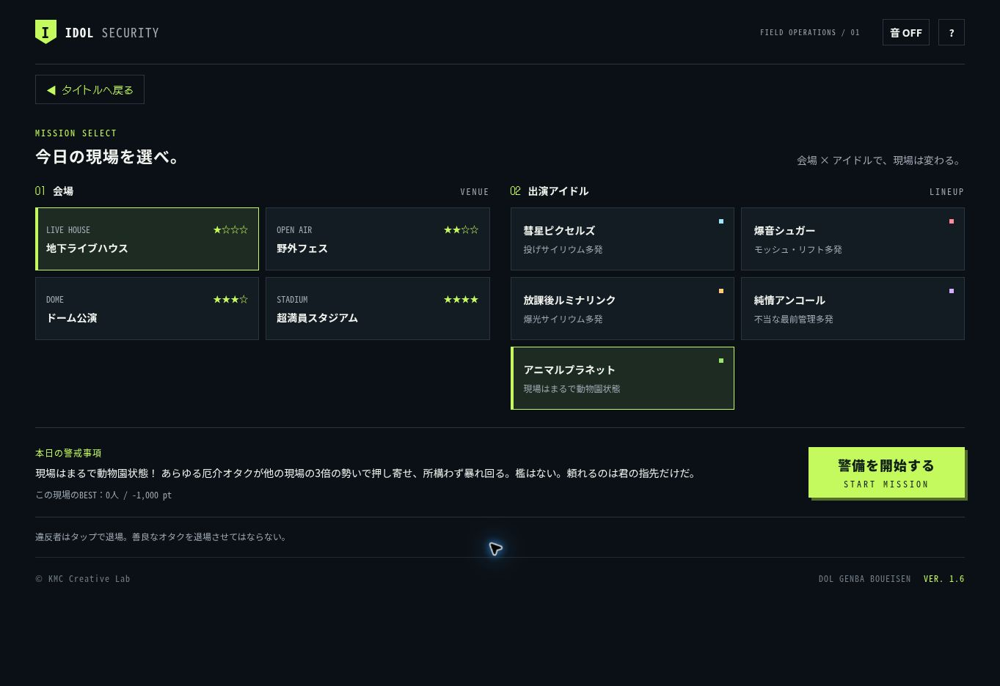

# v1.6 公開確認（2026-10-16 / JST）

## 公開結果

- PR #7: https://github.com/KMC48/dol-genba-security/pull/7
- マージ: `97e65ec9e900581c32ec4f3d0315cef59f3a5821`
- 公開URL: https://kmc48.github.io/dol-genba-security/
- 最終ゲーム配信コミット: `9b81fbf90ab7800020b8e1ebadd54d926802988a`
- Pages成功: https://github.com/KMC48/dol-genba-security/actions/runs/38857886746
- Android APK/lint成功: https://github.com/KMC48/dol-genba-security/actions/runs/38857449217

## 最終レビューで修正した点

1. 既存の `Math.min(.05, elapsed)` による低FPS時の時間切り捨てを解消。全経過時間を最大50msのステップに分けて処理し、1フレームにつき描画は一度。ポーズ・バックグラウンド中は進めない。コミット `801f4ee847077673f50dd79cc3db8488e5b0bc04`。
2. 公開直後、v1.6のHTMLとブラウザに残ったv1.5のJavaScriptが混在する状態を実際に確認。HTMLのJS/CSS URLへ `?v=1.6.0-20261016` を追加して解消。保存領域は削除していない。
3. RELEASE_NOTESの検証用URL説明を、専用開発サーバーだけで有効と明記。

## 公開ブラウザで確認したこと

リモートChromeから通常のUI・数字キー0〜9・Spaceを使用。保存フラグの注入、評価の直接変更、開発用サーバーへの切替は行っていない。操作待ちで見逃しが出るため、S確認の一部は区間の間に一時停止を使用した。

| 項目 | 結果 |
| --- | --- |
| 通常URLの版番号 | タイトル・フッターともVER. 1.6 |
| 未解禁 | 5枠目は「？？？／全アイドルS評価で出演」、disabled |
| URL回避防止 | `?unlock=animal` 付きでも未解禁時はdisabled |
| A/B評価 | 解禁せず |
| 1〜3組S | 選択不可を維持 |
| 4組目S | 結果に「全アイドルS評価達成！ 隠しアイドル『アニマルプラネット』が出演決定！」 |
| 再読み込み | 通常URLで解禁を維持し、選択・開始できる |
| 専用画像 | ネコ・ウサギ・パンダ・キツネ・ライオンの5人をステージ上に描画 |
| 大量出現 | 通常より多数の違反者と2桁の番号を確認 |
| 退場一覧 | 行為別・顔別画像と人数を表示、合計が総退場人数と一致 |
| 一般観客 | 入退場と観覧中の移動・応援を確認 |
| 進行 | カウントダウン→60秒→結果、一時停止・再開も動作 |
| 保存 | 再読み込み後にHI-SCOREと各現場BESTを維持 |

通常4組のS確認はすべて地下ライブハウス。全会場の組合せは後述の自動テストで検証した。

| アイドル | 評価 | 退場 | スコア | 見逃し/誤認 |
| --- | --- | ---: | ---: | --- |
| 彗星ピクセルズ | S | 55 | 15,280 | 0 / 0 |
| 爆音シュガー | S | 67 | 20,700 | 0 / 0 |
| 放課後ルミナリンク | S | 54 | 16,800 | 0 / 0 |
| 純情アンコール | S | 56 | 17,400 | 0 / 0 |

既存仕様は人数を優先して現場BESTを保存するため、上表の各プレイのスコアとタイトルHI-SCOREは必ずしも一致しない。検証後のタイトルは17,400 pt、彗星ピクセルズのBESTは以前の56人 / 12,810 ptを維持した。保存方式や保存キーの変更・削除は実施していない。利用者本人の別端末内にある保存データにはアクセスしていない。

## 自動検証と配信照合

- Node.js 24.19.0: `npm run check` / `npm test` / `npm run build` 成功。
- 28件＋全16ミッション成功。10/4/1/0.2FPS、120秒バックグラウンドと再開を追加検証。
- 正規解禁、異なる順番と会場、重複S、途中離脱、破損データ、保存拒否、Web/native相当URL、開発プレビューの非永続性を検証。
- 公開サイトから取得したHTML/CSS/JSと15画像の合計18ファイルがソースとバイト一致。画像のSHA-256もmanifestと一致。
- 公開サイトから取得したgame.jsとindex.htmlを使って28件＋全16ミッションを再実行し成功。これはNode VM検証であり、ブラウザ・実機試験とは区別する。
- アニマルプラネットの通常組平均3倍以上の出現量を全4会場で検証。

## Android・iOS反映範囲

| 対象 | 状況 |
| --- | --- |
| 共通ソース | v1.6.0と解禁分離・時間修正をmainへ反映 |
| Android | 最新ゲームロジックのCI #9でAPK生成・lint・同梱照合成功 |
| Android APK | CIの成果物名は旧命名の `dol-genba-v1.4-debug-...` だが、実際のversionNameは1.6.0。対象headは801f4ee |
| 公開後のHTML修正 | APK生成の後に追加したJS/CSSクエリ版番号は既存APKには未収録。ゲームロジック・画像は同じ。次回ビルドで収録される |
| 最終ソースの同期 | `sync:android` / `verify:android` / `sync:ios` 成功。両OSの同梱19ファイルが最終wwwと一致 |
| iOS | MARKETING_VERSION 1.6.0、最新Web素材の同期まで確認。今回のiOSネイティブビルドは未実施 |
| 実機・ストア | Android/iOS実機、署名AAB/IPA、TestFlight、ストア配信は未実施 |

GitHub Pagesを更新しても、インストール済みアプリは自動更新されない。アプリへの配布には最新mainから再ビルドと通常の配信が必要。

## 公開画面

